<div align="center">

# 같은 5시리즈, 다른 탄소

**BMW 5시리즈 전과정평가(LCA)와 Scope 3·회피배출 적용 사례**

[](https://goalbangg-prog.github.io/BMW-5-series-LCA/)


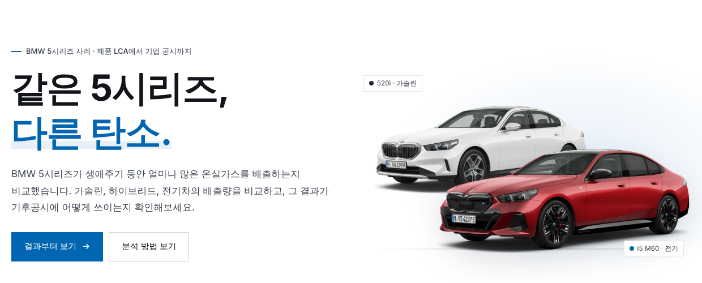

</div>

BMW 5시리즈 다섯 차종이 만들어져 폐차될 때까지 배출하는 온실가스를 **한국 주행 조건**으로 다시 계산했습니다. 그 결과를 수입·판매사인 **BMW 코리아의 Scope 3 산정**과 **회피배출 분석**까지 이었습니다. 웹 계산기에서 주행거리, 충전 전력, 충전 습관을 바꾸면 Scope 3와 회피배출 숫자도 함께 다시 계산됩니다. (PC 화면에 맞춰 제작)

> [!NOTE]
> 공개자료로 수행한 개인 분석입니다. 인증된 EPD, 제3자 검증을 받은 제품 탄소발자국(PCF), 회사의 공식 Scope 3 인벤토리가 아니며, Scope 3와 회피배출은 방법을 보여주기 위한 예시입니다.

---

## 한눈에 보기

| 구분 | 내용 |
|---|---|
| 질문 | 같은 5시리즈라도 동력(가솔린·플러그인 하이브리드·전기)에 따라 생애주기 배출은 얼마나 다르고, 그 결과는 기업 공시에 어떻게 쓰이는가 |
| 대상 | 일상형 520i(가솔린) · 530e(PHEV) · i5 eDrive40(전기), 고성능 M5(PHEV) · i5 M60(전기) |
| 기능단위 | 승용차 1대로 20만 km 주행 (2025년부터 15년) |
| 시스템 경계 | 요람에서 무덤까지. 정비·소모품·인프라 등 제외 |
| 산정 기준 | ISO 14040·14044 (LCA), ISO 14067 (탄소발자국, IPCC 6차 보고서 값), GHG Protocol Scope 3, WBCSD 회피배출 지침(2023) |
| 배경 데이터 | 한국환경산업기술원(KEITI) 국가 LCI DB 데이터셋 |
| 기간·인원 | 2026년 10월 · 1인 (기획, 데이터 수집, 모델링, 웹 구현) |

### 분석 흐름

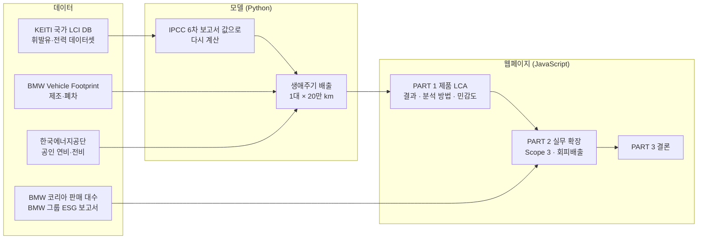

---

## 왜 이 분석을 했나

1. **BMW가 공개한 LCA는 유럽 조건입니다.** 유럽 전력과 유럽 시험 연비를 기준으로 하므로, 한국 전력과 국내 공인 연비로 다시 계산하면 결과가 달라집니다.
2. **제품 LCA와 기업 공시는 따로 다뤄지기 쉽습니다.** 차 한 대의 LCA 결과가 수입사의 Scope 3 항목으로 어떻게 나뉘고, "전기차로 탄소를 줄였다"는 회피배출 주장이 언제 성립하는지를 한 흐름으로 보여주고자 했습니다.

---

## 숫자로 보는 반전 5가지

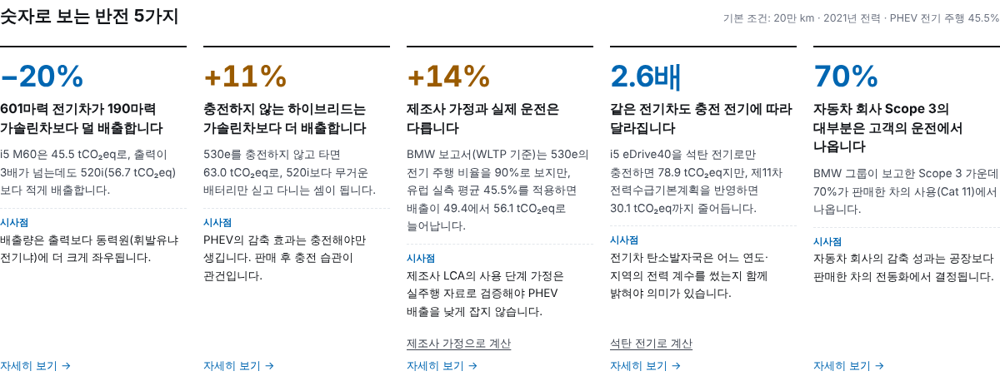

---

## PART 1 · 제품 LCA

### 차 한 대의 생애주기 배출

기본 조건: 한국 전력 2021년 값 고정(국가 LCI DB), 20만 km, PHEV 전기 주행 비율 45.5%

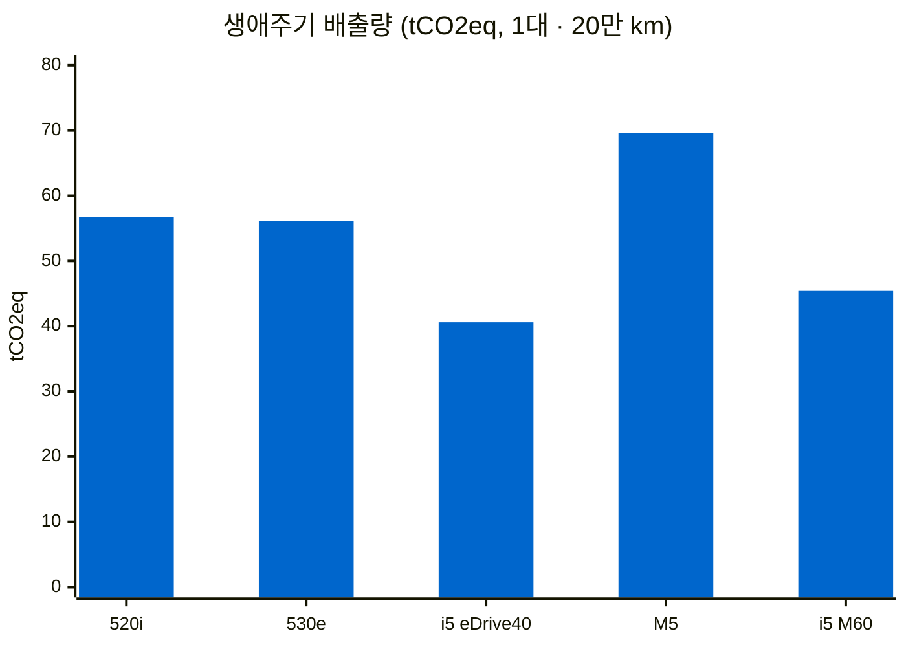

| 차종 | 생애주기 배출 | 1 km당 | 비교 |
|---|---:|---:|---|
| 520i (가솔린) | 56.7 tCO₂eq | 283 g | 일상형 기준 차량 |
| 530e (PHEV) | 56.1 tCO₂eq | 280 g | 520i 대비 −1% |
| i5 eDrive40 (전기) | **40.6 tCO₂eq** | 203 g | 520i 대비 **−28%** |
| M5 (PHEV) | 69.6 tCO₂eq | 348 g | 고성능 기준 차량 |
| i5 M60 (전기) | **45.5 tCO₂eq** | 228 g | M5 대비 **−35%** |

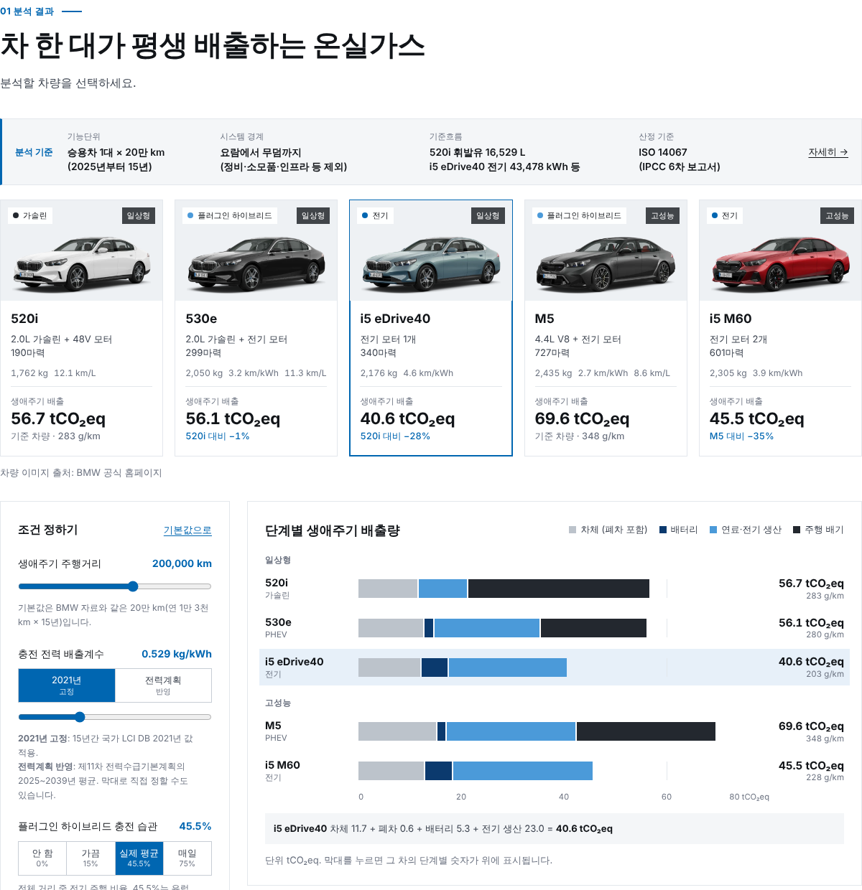

- **제품:** i5 eDrive40은 배터리 제조로 5.9 tCO₂eq를 더 배출하지만 약 5.4만 km를 달리면 만회합니다. 순위가 뒤집히려면 전력 배출계수가 0.90 kgCO₂eq/kWh를 넘어야 합니다(이 분석은 0.53).
- **충전 습관:** 530e는 충전 없이 타면 63.0 tCO₂eq로 520i보다 11% 많이 배출합니다. BMW 보고서의 WLTP 기준 전기 주행 비율 90% 대신 유럽 실측 45.5%를 적용하면 49.4 tCO₂eq에서 56.1 tCO₂eq로 늘어납니다.
- **민감도:** 가정 11개를 하나씩 가장 불리한 값까지 바꿔도 i5 eDrive40이 520i보다 1대당 7.3~27.1 tCO₂eq 적게 배출해, 결론이 유지됩니다.

### 시스템 경계

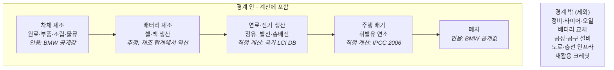

---

## PART 2 · 실무 확장

### LCA 결과를 BMW 코리아의 Scope 3로

PART 1은 차 한 대의 탄소발자국(ISO 14067), PART 2는 회사가 판매한 차 전체를 보고하는 기준(GHG Protocol)입니다. 공시용 전력 계수(2023년 국가 전력배출계수 0.4173 kgCO₂eq/kWh)를 따로 써서 숫자가 조금 다릅니다.

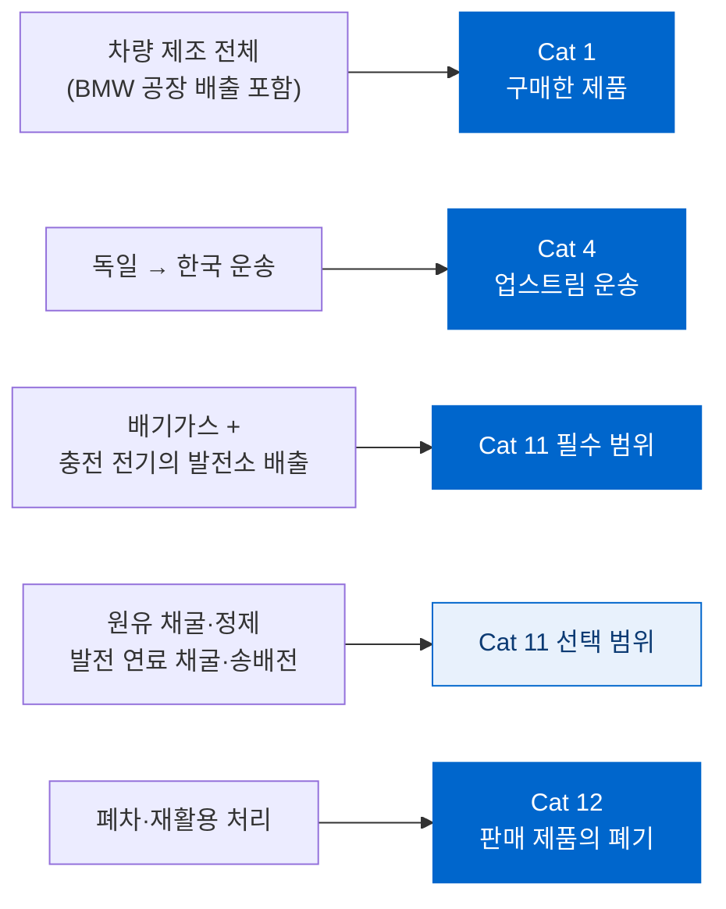

| 2025년 상반기 판매분 (예시 산정) | 값 |
|---|---:|
| 산정 대상 (520i · 530e · i5) | 9,456대 (5시리즈 12,786대 중 74%) |
| Cat 11 필수 범위 | 약 31.5만 tCO₂eq |
| Cat 1 차량 구매 | 약 10.6만 tCO₂eq |
| 산정 합계 중 Cat 11 필수 비중 | 72% |

### 회피배출: i5를 팔아서 피한 배출

만약 i5가 없었다면 고객은 다른 차를 탔을 것입니다. i5를 구매함으로써 온실가스를 덜 배출하는 것을 회피배출이라고 합니다. WBCSD 회피배출 지침(2023)으로 분석했습니다.

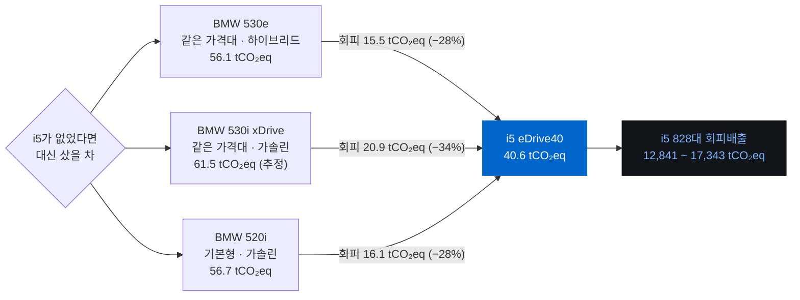

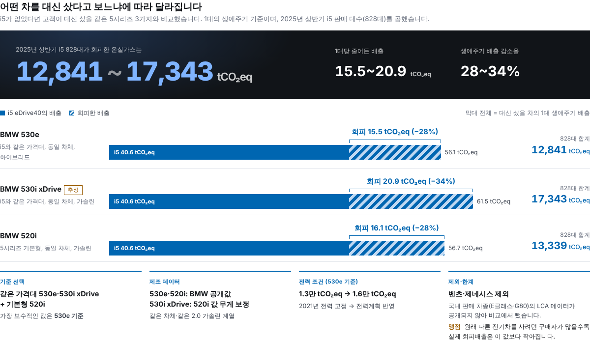

| 점검 항목 | 내용 |
|---|---|
| 조건 1 · 회사 | BMW는 2030년 목표가 SBTi 검증을 받았고, Scope 3 실적을 매년 공개 ✅ |
| 조건 2 · 제품 | 배기가스 없는 전기 승용차는 EU 택소노미의 저탄소 운송 활동 ✅ |
| 조건 3 · 기여 | 완성차(최종 제품)로 직접 기여 ✅ |
| 가장 보수적인 값 | 같은 가격대 530e 기준 12,841 tCO₂eq |
| 경쟁사 제외 | 벤츠 E클래스·제네시스 G80은 국내 판매 차종의 LCA 데이터가 공개되지 않아 제외 |
| 맹점 | 원래 다른 전기차를 사려던 구매자가 많을수록 실제 회피배출은 이 값보다 작아짐 |

---

## PART 3 · 결론

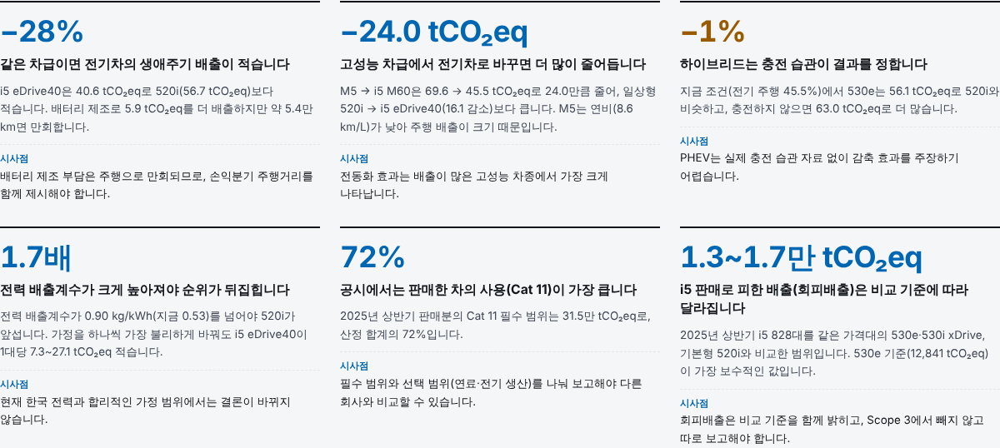

---

## 분석 중 판단한 것

| 쟁점 | 선택 | 이유 |
|---|---|---|
| 국가 LCI DB 데이터셋의 표시값을 그대로 쓸지 | 원소 흐름으로 다시 계산 | 휘발유 표시값(0.917 kg/kg)은 유럽 EF 방식이고 100년 이후 장기 배출(0.125)까지 포함합니다. ISO 14067 기준으로 맞추면 0.792 kg/kg입니다 |
| LCA에 쓸 전력 계수 | 국가 LCI DB 2021년 데이터셋 그대로 (0.529 kgCO₂eq/kWh) | DB에 있는 소비 믹스 값이 이것뿐이고, 최신값보다 높아 전기차에 불리한(보수적인) 방향입니다 |
| Scope 3 Cat 11에 쓸 전력 계수 | 2023년 국가 전력배출계수 (0.4173 kgCO₂eq/kWh) | 2025년 판매분을 보고하는 시점의 최신 공표값이라 공시용으로 따로 적용했습니다 |
| 수입사의 Cat 1 범위 | 공장 배출까지 포함한 차량 전체 | BMW 그룹의 Scope 1·2(공장 배출)도 BMW 코리아 입장에서는 구매한 제품의 배출입니다 |
| 자동차운반선 해상운송 데이터셋 | 쓰지 않음 | BMW 제조 값의 물류에 이미 출고 운송이 포함되어 있어 더하면 이중 계산입니다 |
| 발전원별 전력 데이터셋 합산 | 쓰지 않음 | 2023년 비중으로 합치면 생산 믹스 데이터셋보다 약 20% 높고, 원인을 확인하지 못했습니다 |
| 회피배출 비교 기준 | 같은 5시리즈 3종 (530e·530i xDrive·520i) | 520i는 i5보다 약 2,500만 원 저렴해 대안으로 약해, 가격대가 같은 차를 함께 두었습니다. 경쟁사는 LCA 미공개로 추정을 피하려고 뺐습니다 |
| M5·i5 M60 제조 배출 | 세 차종에서 역산한 계수로 추정 | BMW가 두 차종의 LCA를 공개하지 않았습니다. 추정임을 화면에 표시했습니다 |

---

## 검증

| 항목 | 기준값 | 이 모델 | 차이 |
|---|---:|---:|---:|
| 휘발유 연소 CO₂ vs 국가 LCI DB 평가계수 (kgCO₂/L) | 2.085 | 2.086 | +0.0% |
| 휘발유 생산: 국가 LCI DB vs 영국 DESNZ 2026 (kgCO₂eq/L) | 0.551 | 0.586 | +6.4% |
| 전력: 국가 LCI DB vs IPCC 2006 + DESNZ 재계산 (kgCO₂eq/kWh) | 0.512 | 0.529 | +3.4% |
| 2023년 전력 직접배출 재현 vs 공식 계수 (보정 전, kgCO₂eq/kWh) | 0.417 | 0.396 | −5.1% |
| BMW 520i 유럽 사용단계 재현 (tCO₂eq) | 34.0 | 33.8 | −0.7% |

웹 계산기의 다섯 차종 결과, Scope 3 Cat 11, 회피배출 값이 Python 모델 결과와 같은 것을 확인했습니다. 모델을 다시 실행하면 `outputs/`의 결과가 그대로 재현됩니다.

---

## 데이터 출처

| 입력 | 출처 |
|---|---|
| 휘발유 생산 | KEITI 국가 LCI DB `Gasoline; Production mix, at plant` (2020년 자료) |
| 충전 전력 | KEITI 국가 LCI DB `Electricity, market mix, including T&D losses` (2021년 자료) |
| 미래 전력 | 제11차 전력수급기본계획, EPSIS 2023 발전 실적, 2006 IPCC 고정연소 계수 |
| 공시용 전력 | 2023년 국가 전력배출계수 0.4173 tCO₂eq/MWh |
| 휘발유 연소 | 2006 IPCC Guidelines Vol.2 Ch.3, 에너지법 시행규칙 에너지열량 환산기준(2022) |
| 제조·폐차 | BMW Vehicle Footprint 520i · 530e · i5 eDrive40 (2023 MY, ISO 14040/44, TÜV Rheinland 검토) |
| 연비·전비 | 한국에너지공단 자동차 표시연비 (2026.04) |
| 충전 습관 | Energies 19(5) 1165 (2026), 유럽 PHEV 457,303대 실주행 기록 |
| 배터리 제조 범위 | Nature Communications 15, 10301 (2024) |
| Scope 3 비교 | BMW Group ESG Overview FY2025 |
| 판매 대수 | BMW 코리아 5시리즈 2025년 상반기 판매 보도자료 (2025.7.7) |
| 회피배출 비교 차량 | 530i xDrive: BMW 코리아 홈페이지(복합 11.1 km/L), BMW USA 2024 5 Series 기술 제원(무게) · 530e 가격: 비즈워치(2024.3.5) |
| 공시·회피배출 방법 | GHG Protocol Scope 3 Technical Guidance, WBCSD Guidance on Avoided Emissions (2023) |

국가 LCI DB 데이터셋은 KEITI soda4LCA 노드(http://133.186.241.65)에서 ILCD 형식으로 내려받았습니다. 입력값별 자료 유형과 검증 상태는 웹페이지 부록의 "입력값 전체" 탭에 있습니다. 모든 입력은 공개된 2차 자료이며, 직접 측정한 1차 자료는 없습니다.

---

## 한계

- 온실가스 배출량만 산정했습니다. 다른 환경 영향은 다루지 않았습니다.
- 제조 단계는 BMW가 공개한 결과값을 인용했습니다. 직접 모델링한 부분은 연료·전기 생산과 주행 배출입니다. M5·i5 M60 제조 배출은 추정입니다.
- 국가 LCI DB 데이터셋은 2020~2022년 자료이고, 전력은 2021년 값이라 전기차에 다소 불리하게 계산됐을 수 있습니다.
- 폐차는 BMW 자료대로 세 차종 모두 0.6 tCO₂eq이며, 큰 배터리의 해체·재활용 부담 차이는 반영하지 못했습니다.
- 충전 습관은 국내 통계가 없어 유럽 자료를 썼습니다.
- 530i xDrive의 제조 배출은 BMW가 공개하지 않아, 같은 차체·같은 2.0 가솔린 계열인 520i의 공개값을 무게 비율로 보정했습니다.
- Scope 3는 BMW 코리아의 실제 운임 부담 조건과 트림별 판매 대수를 모르는 상태의 예시입니다.
- 공개 비교를 하는 LCA는 ISO 14044상 외부 전문가 검토 대상이지만, 이 분석은 검토를 받지 않았습니다.

---

## 폴더 구성과 실행

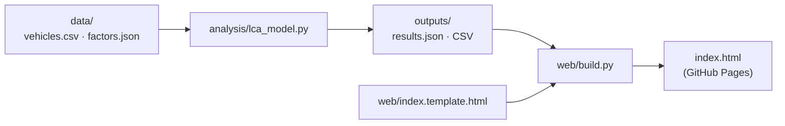

```
index.html                 # 웹페이지 (GitHub Pages)
img/                       # 차량 이미지
docs/images/               # README용 화면 캡처
data/vehicles.csv          # 차종별 입력값과 출처
data/factors.json          # 배출계수, 국가 LCI DB 데이터셋 값, Scope 3·회피배출 입력값과 출처
analysis/lca_model.py      # 계산 모델 (Python)
outputs/                   # 결과 CSV(기준흐름, 손익분기, 민감도 등)와 results.json
web/index.template.html    # 웹페이지 원본
web/build.py               # results.json을 템플릿에 넣어 index.html 생성
```

```bash
pip install numpy pandas
python analysis/lca_model.py   # outputs/ 생성
python web/build.py            # index.html 생성
```

**기술 스택:** Python (Pandas, NumPy) · JavaScript (SVG 차트, 계산기) · HTML/CSS · GitHub Pages

---

## 이미지·상표

차량 이미지는 BMW 공식 홈페이지의 이미지(520i, 530e, i5 eDrive40, M5, i5 M60)를 사용했으며, 저작권은 BMW AG에 있습니다. BMW와 관계없는 개인 분석이며, BMW, 5시리즈, M5, i5는 BMW AG의 상표입니다.

---

<div align="center">

만든 사람 : 김수현 · [포트폴리오](https://goalbangg-prog.github.io/Portfoilo-V4/)

</div>
